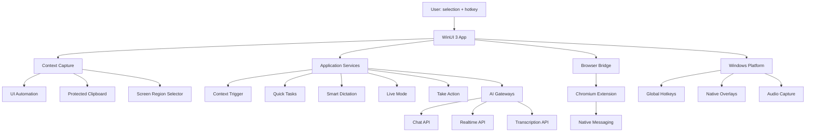

# Cursivis Next

> **A shortcut-driven, context-aware Windows AI layer that turns what is already on screen into the next useful action.**

**Selection = Context.**  
**Trigger = Intent.**  
**Cursivis = Action.**

[](https://www.microsoft.com/windows)
[](https://dotnet.microsoft.com/)
[](https://learn.microsoft.com/windows/apps/winui/winui3/)
[](LICENSE)

**Built for**: [Devpost Build with AI: Basics Hackathon](https://build-with-ai-basics.devpost.com/)

---

## 🎯 The Problem

Conventional AI workflows create friction: select text → copy → switch to AI chat → reconstruct context → wait → copy result → switch back → paste. This tax compounds all day long.

**Cursivis Next takes the opposite view**: The active application, selected text, and current task are already valuable context. A global trigger should turn that context into focused AI capabilities without forcing you into another workspace.

## ✨ What It Does

Cursivis Next is a Windows-first AI productivity layer built with **WinUI 3**, **.NET 8**, and **AI APIs**. Its central loop:

```
Select → Trigger → Understand → Respond → Refine or Act
```

### Core Features

- **Context Trigger** (`Ctrl+Alt+O`): Select text anywhere, press hotkey, get AI-powered insights instantly
- **Smart Dictation** (`Ctrl+Alt+U`): Voice-to-text with intelligent formatting, inserted directly at cursor
- **Quick Tasks** (`Ctrl+Alt+Y`): Customizable AI operations (default: Prompt Optimizer)
- **Live Mode** (`Ctrl+Alt+P`): Real-time AI conversation with screen analysis and guidance
- **Take Action** (`Ctrl+Alt+I`): Bounded browser automation for form filling and interactions
- **Global Hotkeys**: System-wide shortcuts with conflict detection and fallback
- **Result Management**: Copy, refine, insert, replace, or undo AI-generated outputs

## 🎬 Quick Demo

1. Select text in **any Windows application**
2. Press **Ctrl+Alt+O**
3. Get instant AI transformation (summarize, explain, format, translate, etc.)
4. Click **Insert** or **Replace** to apply directly
5. Or press **Ctrl+Alt+U** to dictate text via voice
6. Or press **Ctrl+Alt+P** for interactive AI conversation

**Zero app switching. Zero manual copy-paste. Context preserved.**

## 🏗️ Architecture



### Tech Stack

- **Frontend**: WinUI 3 (native Windows UI)
- **Backend**: .NET 8, C# 12
- **Platform**: Windows 10/11 APIs (UI Automation, Hotkeys, Audio)
- **AI Integration**: REST/WebSocket with Claude, GPT, Gemini
- **Browser**: Chromium Manifest V3 extension + native messaging
- **Testing**: xunit, integration tests, deterministic AI mocks

## 📁 Project Structure

```
cursivis-nextt/
├── apps/windows/
│   ├── Cursivis.Windows.App/          # WinUI 3 application
│   ├── Cursivis.Windows.Platform/     # Windows services
│   └── Cursivis.Windows.NativeHost/   # Browser host
├── src/
│   ├── Cursivis.Domain/               # Core models
│   ├── Cursivis.Application/          # Business logic
│   ├── Cursivis.Infrastructure.*/     # AI, Storage, Bridge
├── tests/                             # Unit + integration tests
├── extensions/chromium/               # Browser extension
├── installer/                         # Inno Setup script
├── docs/                              # Architecture docs
└── scripts/                           # Build automation
```

## 🚀 Installation

### Requirements

- **Windows 10** version 2004 (build 19041) or **Windows 11**
- **x64 hardware**
- **AI API key** (Claude, GPT, or Gemini)

### Download & Install

1. Go to **[Releases](https://github.com/UnknownGod2024/cursivis-nextt/releases)**
2. Download the latest `Cursivis-Setup-{version}-x64.exe`
3. Run the installer (approve Windows prompts)
4. If SmartScreen warns about "Unknown Publisher": this beta isn't code-signed yet - only download from official GitHub releases
5. Launch **Cursivis Next** from Start Menu
6. Enter your AI API key in Settings
7. Confirm hotkeys in Settings → Hotkeys
8. Enable "Launch at sign-in" if desired

## 🛠️ Development Setup

### Prerequisites

- Windows 10/11 x64
- [.NET SDK 8.0](https://dotnet.microsoft.com/download/dotnet/8.0) (see `global.json`)
- Visual Studio 2022 (recommended) or .NET CLI
- [Inno Setup 6](https://jrsoftware.org/isinfo.php) (for installer)
- Node.js 22+ (if building website)

### Build from Source

```powershell
# Clone repository
git clone https://github.com/UnknownGod2024/cursivis-nextt.git
cd cursivis-nextt

# Restore dependencies
dotnet restore Cursivis.sln --locked-mode -r win-x64 -p:Platform=x64

# Build Release
dotnet build Cursivis.sln -c Release -p:Platform=x64 --no-restore

# Run tests
dotnet test tests/Cursivis.UnitTests/*.csproj -c Release --no-build
dotnet test tests/Cursivis.IntegrationTests/*.csproj -c Release --no-build

# Run application
dotnet run --project apps/windows/Cursivis.Windows.App/*.csproj -c Release -p:Platform=x64 --no-build
```

### Build Installer

```powershell
.\scripts\build-release.ps1 -Version 0.1.0-beta.4
# Output: artifacts/release/Cursivis-Setup-0.1.0-beta.4-x64.exe
```

### Validation Scripts

```powershell
.\scripts\check-secrets.ps1          # Ensure no API keys committed
.\scripts\verify-extension.ps1       # Validate browser extension
```

## 🎓 How It Works

### Context Capture

Cross-application text capture is complex - Cursivis uses a layered approach:

1. **UI Automation** (preferred): Query focused control's selection
2. **Protected Clipboard** (fallback): Snapshot → Ctrl+C → read → restore
3. **Safeguards**: Reject browser chrome/omnibox, cross-check sources
4. **Target Preservation**: Remember source for insert/replace/undo

### AI Integration

| Feature | API Used | Purpose |
|---------|----------|---------|
| Context Trigger, Quick Tasks | Chat Completions | Text understanding and transformation |
| Smart Dictation | Transcription | Voice-to-text with formatting |
| Live Mode | Realtime WebSocket | Duplex conversation with tools |
| Screen Analysis | Vision API | Multimodal image understanding |

### Browser Automation

1. User triggers Take Action
2. AI generates structured action plan
3. User reviews and confirms
4. Plan sent to Chromium extension via **authenticated named pipe**
5. Extension executes with **safety checks** (no purchases, no deletions)
6. Each step verified before proceeding

**Security**: Extension allowlisted, same-user pipe, typed contracts, no generic shell access.

## 🔒 Safety & Privacy

- API keys stored with Windows DPAPI (user-level encryption)
- Screen capture explicit, requires user action
- Navigation Guidance requires privacy opt-in
- Browser actions bounded and confirmed
- No ambient monitoring or data collection
- Settings and memories stored locally only

## ⚙️ Hotkeys Reference

| Feature | Default | Behavior |
|---------|---------|----------|
| Context Trigger | `Ctrl+Alt+O` | Capture text or screen region |
| Smart Dictation | `Ctrl+Alt+U` | Start voice transcription |
| Quick Task | `Ctrl+Alt+Y` | Run Prompt Optimizer (customizable) |
| Live Mode | `Ctrl+Alt+P` | Start/stop AI conversation |
| Take Action | `Ctrl+Alt+I` | Browser automation flow |
| Settings | `Ctrl+Alt+S` | Open settings window |
| Cancel | `Ctrl+Alt+Escape` | Stop current operation |

> ⚠️ **Conflicts**: Cursivis detects when another app owns a shortcut and registers a fallback. Check **Settings → Hotkeys** for active mappings on your PC.

## 📊 Testing

### Unit Tests (169 passing)
- Application and domain logic
- State management, validation, error handling
- All dependencies mocked

### Integration Tests (76 passing)
- Hotkey registration/rollback
- Settings persistence and migration
- Audio session lifecycle
- Browser bridge contracts

### Manual Test Scenarios
- Context capture in: Notepad, VS Code, Chrome, Word, Teams
- Dictation in: Outlook, browser inputs, Slack
- Live Mode: conversation, tool calls, interruption
- Take Action: Google Forms, surveys, simple web forms
- Multi-monitor and high-DPI displays

## 🎯 Devpost Hackathon Alignment

### Judging Criteria

**1. Functionality**  
✅ All Phase 1 features implemented and working  
✅ Edge cases handled (no selection, app conflicts, network errors)

**2. Design & UX**  
✅ Hotkey-driven, minimal UI (transient overlays)  
✅ Visual feedback via orb states and animations  
✅ Keyboard-accessible, DPI-aware

**3. Innovation**  
✅ Novel approach: AI comes to user's context, not vice versa  
✅ Deep Windows platform integration  
✅ Safety-first bounded automation

**4. Technical Complexity**  
✅ Multi-layer architecture (Domain, Application, Infrastructure, Platform)  
✅ Cross-process: browser extension ↔ native messaging ↔ named pipe  
✅ Windows APIs: UI Automation, hotkeys, audio, overlays  
✅ Multiple AI capabilities: chat, realtime, transcription, vision

**5. Impact**  
✅ Solves universal productivity pain (context-switching)  
✅ Daily time savings compound across knowledge workers  
✅ Extensible foundation for future AI-native workflows

## 🤝 Contributing

This is a hackathon submission project. Contributions welcome post-hackathon!

1. Fork the repository
2. Create feature branch: `git checkout -b feature/my-feature`
3. Run tests: `dotnet test`
4. Commit: `git commit -m 'Add my feature'`
5. Push: `git push origin feature/my-feature`
6. Open Pull Request

### Guidelines

- Preserve Domain → Application → Infrastructure dependency direction
- Add tests for new features
- Run `scripts/check-secrets.ps1` before committing
- No API keys, `.env`, or user data in commits

## 📄 License

[MIT](LICENSE) © 2026

## 🙏 Acknowledgments

Built with:
- **WinUI 3** and **.NET 8** - Microsoft
- **AI APIs** - Claude (Anthropic), GPT, Gemini (Google)
- **Chromium Native Messaging** - Google
- **Inno Setup** - Jordan Russell
- **xunit** - xUnit.net community

Special thanks to **Codex and GPT-5.6** for collaboration throughout development (architecture analysis, cross-project refactoring, debugging, testing, build automation).

---

> **The cursor should not merely point at work.**  
> **The selection should become context.**  
> **The trigger should become intent.**  
> **Cursivis should become the beginning of action.**

---

**🎉 Hackathon**: [Devpost Build with AI: Basics](https://build-with-ai-basics.devpost.com/)  
**📦 Download**: [GitHub Releases](https://github.com/UnknownGod2024/cursivis-nextt/releases)  
**📖 Docs**: [docs/](docs/) | [scope.md](scope.md) | [prd.md](prd.md) | [spec.md](spec.md)  
**🐛 Issues**: [GitHub Issues](https://github.com/UnknownGod2024/cursivis-nextt/issues)
